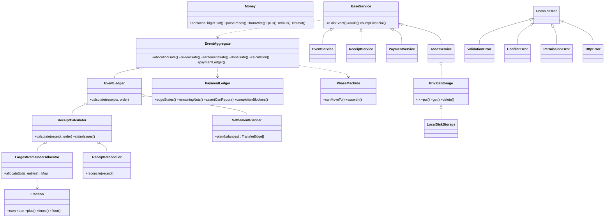
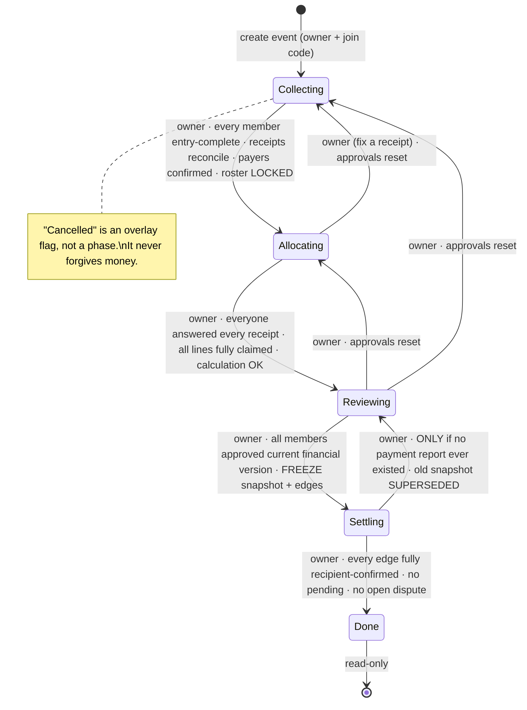
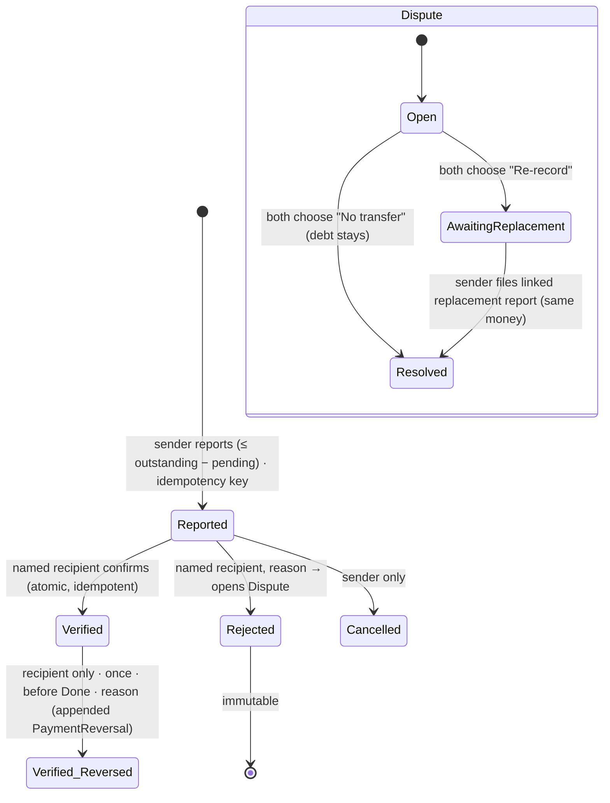
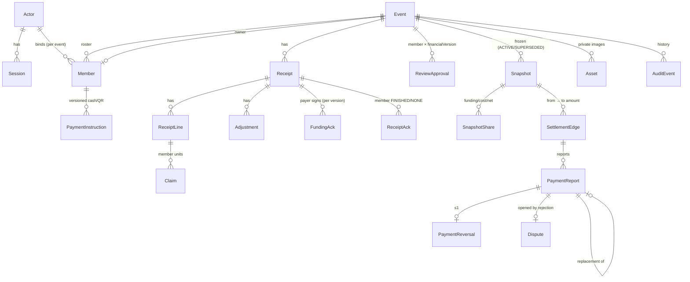

# Architecture

AteAnne is a **modular monolith**: one Next.js app with a layered, object-oriented core and PostgreSQL. There are no microservices, queues, model APIs or bank integrations.

```
Browser (installable PWA)
  │  fetch JSON (decimal-string centavos), HttpOnly session cookie
  ▼
app/api/**/route.ts     ← thin adapters, wrapped by http/route.ts
  │  Origin/CSRF check · session → actorId · size-limited JSON · error → status · no-store
  ▼
server/services/*Service  (application layer, one class per area)
  │  BEGIN; SELECT … FROM "Event" … FOR UPDATE; load EventAggregate; check authority, phase, versions
  ▼
server/aggregate/EventAggregate  (aggregate root over the loaded records)
  │  delegates every rule to …
  ▼
domain/*  (pure classes: no I/O, no framework, exhaustively unit-tested)
  ▼
PostgreSQL (bigint money, CHECK constraints, append-only history)   +   PrivateStorage (outside public/)
```

## Object-oriented design

| Layer | Classes | OOP concepts used |
| --- | --- | --- |
| Value objects | `Money`, `Fraction` | Immutability, encapsulation (private constructor + factories `of`, `parsePesos`, `fromWire`), operator methods |
| Domain services | `LargestRemainderAllocator`, `ReceiptReconciler`, `ReceiptCalculator`, `EventLedger`, `SettlementPlanner`, `PaymentLedger`, `PhaseMachine` | Single responsibility; **composition** (`EventLedger` has a `ReceiptCalculator` and a `SettlementPlanner`; `ReceiptCalculator` has an allocator + reconciler); constructor injection for testability |
| Errors | `DomainError` → `ValidationError`, `ConflictError`, `PermissionError`; `HttpError` → `NotFoundError`, `GoneError`, `RateLimitedError`… | **Inheritance + polymorphism**: the HTTP layer maps by subclass (`statusFor`) without the domain knowing HTTP |
| Aggregate | `EventAggregate`, `EventRepository` | Aggregate root encapsulates loaded records and exposes intention-revealing methods (`allocationGate()`, `paymentLedger()`, `memberForActor()`) |
| Application services | `BaseService` (abstract) → `EventService`, `ReceiptService`, `PaymentService`, `AssetService`; plus `RecoveryService`, `QueryService`, `CleanupService` | **Abstract base class** with the template "lock event → load aggregate → resolve member → act → audit" (`inEvent`) shared by subclasses |
| Ports & adapters | `PrivateStorage` (interface) ← `LocalDiskStorage` | **Interface / dependency inversion**: swap in an object-storage adapter without touching services |
| Infrastructure | `SessionManager`, `SecretGenerator`, `JoinCodeCodec`, `RateLimiter`, `EventViewBuilder` | Encapsulated security primitives |
| Composition root | `AppContainer` | Dependency injection: tests build a container on the test DB + temp storage |
| UI | `ApiClient`, `ApiError` | Small typed client class |



## Event lifecycle



## Payment report state machine



Effects: only **Verified, not reversed** reports reduce an edge's outstanding amount. Pending reports reserve capacity. Rejected or cancelled reports have no financial effect.

## Data model (ER)



Key constraints: money is stored as `BigInt` centavos with `CHECK` bounds (0 to PHP 1,000,000). Uniques: one claim per member and line, one approval per member and version, one funding ack per receipt version, one reversal per report, one idempotency key per sender. Ledger foreign keys use `Restrict`, so a member referenced by money cannot be cascaded away. Whole-event purge is a separate, ordered routine.

## Concurrency and versions

- **Event row lock**: every money-affecting write starts with `SELECT … FOR UPDATE` on the event. This gives one consistent lock order, and concurrent unit claims, reports and confirmations serialize. Tested with parallel requests.
- **Versions**: `Event.structuralVersion` (roster), `Event.financialVersion` (bumped by any money change; approvals bind to it), `Receipt.version` (claims and acks from older versions become stale drafts), `Member.claimVersion` (your own optimistic concurrency, so routine saves do not clash with other members), immutable `Snapshot.id`.
- **Idempotency**: report creation is keyed by sender + key. Verify is a conditional `UPDATE … WHERE status='REPORTED'`, so a double click returns success once. Reversal is unique per report.

## Security model (summary)

Opaque 32-byte session and recovery secrets, stored as SHA-256 only, in HttpOnly SameSite=Lax cookies (`Secure` over HTTPS). Join codes: 10 characters from a 32-symbol alphabet, indexed by HMAC-SHA256 under `JOIN_CODE_HASH_KEY`, AES-GCM encrypted for owner re-display, 7-day expiry, closed at roster lock. Every write checks Origin plus membership, self, author, payer or recipient authority, phase and version on the server. 404 for non-members, so existence does not leak. DB-backed rate limits. Strict Zod schemas. `no-store` on private responses. Strict CSP. Private images are decoded and re-encoded by sharp (metadata stripped), stored under random keys outside `public/`, and served only to authorized members; QR codes go only to their owner and to people who owe them.

## Sprint S7 extensions

- `InstallProvider` captures the single-use native install event across routes. `InstallFirst` prevents mobile create/join from issuing a new identity until installation guidance or an explicit browser choice. iOS uses instructions; its OS Share sheet cannot be invoked by a website.
- `RecoveryPolicy` authorizes only the organizer’s attested reissue; `RecoveryService` issues/redeems hash-only credentials under the event lock, preserving identity and ledger references. Existing browser binding changes only on successful redemption.
- `Receipt.equalSplit` defaults false. `EqualReceiptSplit` owns whole-receipt consent validation and centavo component rounding; `ReceiptService` derives only the caller’s claims. Normal item allocation is unchanged.
- `CorrectionLedger` calculates revised residual balances from corrected economic nets plus all verified, non-reversed transfers across snapshots. Correction uses the normal phase workflow with fresh approvals; `EventService` supersedes only after checking pending/dispute gates. Old snapshot facts and report records remain untouched. `PaymentService` only mutates the active snapshot’s reports. Projection/export includes immutable statement/payment history and equal-policy metadata.
- `ReminderPanel` refreshes the authorized read model, then `remindersFor` produces plain-text phase tasks with no credential inclusion or automatic delivery. It avoids payment nudges while a report is pending.
